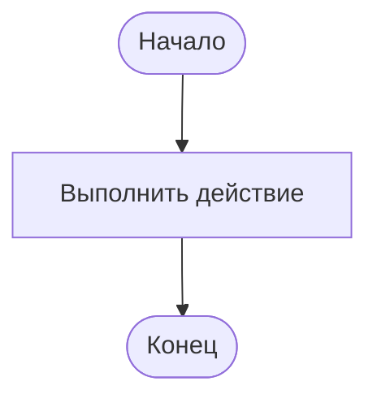
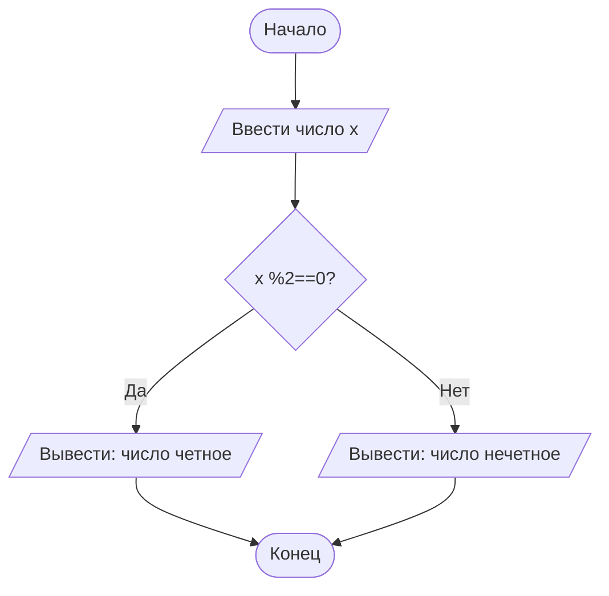
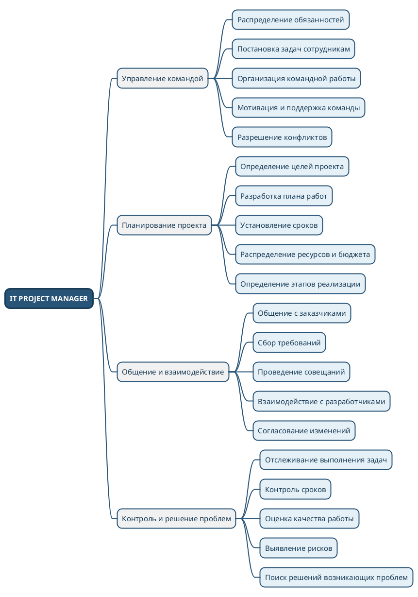
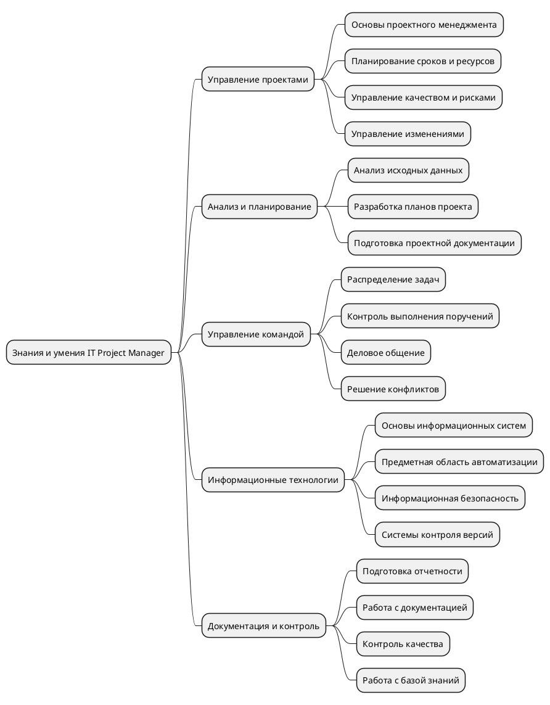
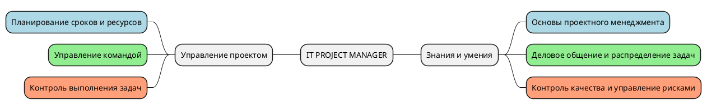
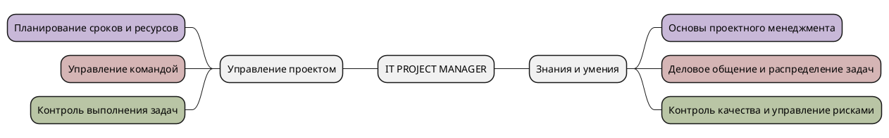

# Лабораторная работа № 3
## Диаграмма как код

**Дисциплина:** Цифровые технологии и искусственный интеллект

**Выполнила:** Ахметшина В. Р.

**Группа:** ИВТ-ИСУ-104Б

**Проверил:** к.т.н., доцент кафедры АСУ Арьков В. Ю.

**Место выполнения:** Уфа

**Год:** 2026

---

## Цель работы

Изучить способы создания диаграмм и блок-схем с помощью графических и текстовых инструментов; освоить основы нотации Mermaid и PlantUML; научиться представлять профессиональную деятельность в виде ментальной карты, систематизировать обязанности, знания и умения специалиста, а также познакомиться с размещением диаграмм в GitHub, Google Colab, Visual Studio Code, Яндекс Вики и Docker.

## Ход работы

В этой лабораторной работе я познакомилась с двумя направлениями: построением блок-схем алгоритмов и созданием ментальной карты IT-профессии. Для карты я выбрала профессию веб-разработчика. В работе использовала текстовые описания Mermaid и PlantUML, которые можно сохранять как исходный код и редактировать.

### Алгоритм

Алгоритм — последовательность шагов, предназначенная для решения задачи или достижения поставленной цели. Сначала определяется исходная задача и ожидаемый результат, затем выбираются действия и устанавливается порядок их выполнения. В программировании алгоритм обычно разрабатывается до написания программы, поскольку предварительное планирование помогает обнаружить логические ошибки.

### Схема алгоритма и ГОСТ

Основные обозначения: терминатор — начало или конец; прямоугольник — процесс или действие; ромб — проверка условия; параллелограмм — ввод или вывод; линия со стрелкой — направление потока. Подписи на ветвях условия должны ясно указывать, какой путь соответствует каждому результату проверки

В качестве отечественного стандарта используется ГОСТ 19.701-90 «Единая система программной документации. Схемы алгоритмов, программ, данных и систем. Условные обозначения и правила выполнения». Он устанавливает графические символы и правила их применения


*Рисунок 1. Отечественный ГОСТ*

### Flowchart и Workflow Diagram

Flowchart — блок-схема, которая показывает логику выполнения алгоритма. В ней отображаются операции, условия, развилки, ввод исходных данных и вывод результатов

Workflow Diagram — диаграмма рабочего процесса. Она описывает ход выполнения работы в организации или проекте. В ней могут быть показаны этапы процесса, роли участников, передача задач между подразделениями, согласование и точки принятия решений

### Построение схемы в Draw.io

Для построения блок-схем я использовала редактор diagrams.net (Draw.io). В нём можно перетаскивать фигуры на рабочее поле, соединять их стрелками, добавлять подписи и сохранять готовую схему в разных форматах

Для первой схемы используется три элемента: блок начала, блок действия и блок завершения. В палитре Flowchart следует выбирать специальный элемент Terminator для начала и конца

Простейшая схема включает начало, действие и конец. Она показывает общий принцип: алгоритм начинается, выполняет указанную операцию и завершается


*Рисунок 2. Базовая блок-схема, сделанная в Draw.io*


*Рисунок 3. Скриншот с сайта diagrams.net*

## Diagram as Code

Diagram as Code — подход, при котором диаграмма создаётся не ручным размещением фигур, а с помощью текстового сценария. Пользователь записывает названия блоков, их свойства и отношения между ними. Программа интерпретирует сценарий и автоматически строит графическое представление

### Mermaid Live Editor

Mermaid — инструмент для создания диаграмм с помощью текстового синтаксиса. В нём описываются элементы и связи, а редактор преобразует запись в графическое изображение. Для знакомства используется Mermaid Live Editor.

**Пример простой схемы:**




*Рисунок 4. Блок-схема Mermaid*

Квадратные скобки задают прямоугольный блок действия, квадратные и круглые одновременно — терминатор , а стрелка --> показывает направленную связь. Параллелограмм может использоваться для ввода или вывода данных

В Mermaid Live Editor доступны варианты экспорта PNG и SVG. PNG подходит для вставки в документы, SVG удобен для масштабирования и использования в средах, поддерживающих векторную графику

### Схема сложнее

Добавилось ввод числа, вывод сообщения, проверка условия. Результат выводит четность или нечетность числа

**Программа:**


*Рисунок 5. Сложная блок-схема*


*Рисунок 6. Скриншот с программой усложнённой блок-схемы*

GitHub поддерживает отображение диаграмм Mermaid непосредственно в Markdown-файлах. Это позволяет хранить исходное описание диаграммы в репозитории и показывать результат в браузере без отдельного изображения.




*Рисунок  7. Вставка простейшего кода на GitHub*

### Google Colab и Mermaid Ink

**Программа для ввода в Google Colab:**

```python
import base64
from IPython.display import Image, display
import matplotlib.pyplot as plt
def mm(graph):
    graphbytes = graph.encode("utf8")
    base64_bytes = base64.urlsafe_b64encode(graphbytes)
    base64_string = base64_bytes.decode("ascii")
    display(Image(url="https://mermaid.ink/img/" + base64_string))

mm("""
flowchart TD
    A([Начало]) --> B[Ввести число x]
    B --> C{x % 2 == 0?}
    C -- Да --> D[/Вывести: число четное/]
    C -- Нет --> E[/Вывести: число нечетное/]
    D --> F([Конец])
    E --> F
""")
```


*Рисунок 8. Mermaid код в Google Colab*


*Рисунок 9. Итоговая диаграмма из Google Colab*

### Mermaid в Visual Studio Code

Visual Studio Code — редактор исходного кода, расширяемый дополнительными модулями. В пособии предлагается использовать Markdown Preview Mermaid Support, добавляющее поддержку Mermaid в предварительный просмотр Markdown.


*Рисунок 10. Программа в VS Code*

### Mermaid в Docker

Docker — платформа контейнеризации, позволяющая запускать приложения в изолированной среде. В лабораторной работе рассматривается запуск Mermaid Live Editor в контейнере и обращение к нему через браузер. Приложение выполняется на локальном компьютере.

В примере используется порт 8080. После запуска Docker Desktop показывает состояние контейнера Running и опубликованный порт. Для открытия сервиса используется localhost с указанным портом


*Рисунок 11. Код Mermaid в Docker*

## Mind Map и PlantUML

Mind Map — ментальная карта, представляющая информацию в виде дерева. В центре располагается основная тема, от которой отходят ветви с более узкими понятиями. Каждый следующий уровень раскрывает предыдущий.

Ментальные карты применяются для структурирования знаний, планирования, подготовки проектов, анализа предметной области и представления профессиональных компетенций.

PlantUML — инструмент для создания диаграмм на основе текстового описания. UML расшифровывается как Unified Modeling Language — унифицированный язык моделирования. Для ментальной карты используется режим Mindmap.

Иерархия задаётся количеством звёздочек в начале строки: корневой элемент — одна звёздочка, элементы следующего уровня — две, подпункты — три. @startmindmap начинает описание, @endmindmap завершает его.

Знак минуса используется для размещения ветвей слева от корневого элемента, знак плюса — справа. Это позволяет расположить трудовые функции и знания с умениями по разные стороны от названия профессии

Выбрана профессия веб-разработчика для создания ментальной карты. В ответвлениях его сферы деятельности


*Рисунок 12. Простейшая Mind Map*


*Рисунок 13. Скриншот Mind Map с кодом PlantUML*

### Выбор IT-профессии

Для ментальной карты выбрана профессия веб-разработчика. Это специалист, который создаёт и поддерживает веб-сайты и веб-приложения. В зависимости от специализации он работает с пользовательской частью сайта (frontend), серверной логикой и обработкой данных (backend) либо сочетает оба направления (fullstack).

**Промпт карьерной консультации:**

> Роль: Ты — профессиональный карьерный консультант с опытом профориентации, подбора профессий и анализа личных качеств человека.

> Задача:  Проведи подробную индивидуальную карьерную консультацию, цель которой — определить наиболее подходящую для меня профессию с учётом моих интересов, способностей, личных качеств, образования и предпочтений.

**Порядок работы:**

1. Задавай мне вопросы о моих увлечениях, интересах и занятиях, которые приносят удовольствие.

2. Выясни, какие у меня есть навыки, способности и сильные стороны.

3. Определи, какой формат работы мне больше подходит: командная или индивидуальная работа, офис или удалённая работа, творческая или аналитическая деятельность.

4. Узнай, какие предметы и направления обучения мне интересны, а какие вызывают трудности.

5. Выясни мои карьерные цели, ожидания от заработной платы и перспективы профессионального развития.

6. На основании моих ответов проанализируй подходящие направления деятельности.

**Результат консультации:**

**После завершения опроса:**

- Предложи три наиболее подходящие мне профессии.
- Объясни, почему каждая из них соответствует моим интересам и способностям.
- Опиши основные обязанности и необходимые навыки для каждой профессии.
- Сравни предложенные варианты и выбери один наиболее подходящий.
- Объясни, с чего лучше начать обучение и как можно получить первый опыт работы.
**Важные условия:**

> Не делай поспешных выводов. Задавай вопросы последовательно, по одному за раз. Учитывай мои ответы и при необходимости уточняй информацию. Не навязывай мне конкретную профессию. Рекомендация должна основываться на результатах нашей беседы.

Запрос содержит роль, контекст, критерии сравнения и требования к форме ответа, что позволяет получить структурированную консультацию

Рекомендованная профессия: IT Project Manager (менеджер IT-проектов)

### Дерево трудовых функций


*Рисунок 14. Ментальная карта по выбранной профессии*

Программа, которую написала нейросеть для ментальной карты




*Рисунок 15. Ментальная карта по программе нейросети*

Программа, с добавлением навыков из SWEBOK Guide



### Объединение деревьев

На предыдущих этапах подготовлены две структуры: дерево трудовых функций и дерево знаний и умений. Первая часть показывает, что делает специалист, вторая — какие компетенции помогают ему выполнять действия. Следующий этап — объединить их в одну ментальную карту


*Рисунок 16. Объединённая карта*

### Цветовое оформление

**Программа, для цветной карты:**




*Рисунок 17. Объединённая, раскрашенная и уменьшенная карта*

**Значение цветов:**

Голубой — планирование и основы проектного менеджмента

Зелёный — управление командой и деловое общение

Оранжевый — контроль задач, качества и рисков

**Программа, для нестандартных цветов:**




*Рисунок 18. Объединённая карта с нестандартными цветами*

## Анализ документов с помощью ИИ


*Рисунок 19. Результат опроса Perplexity*


*Рисунок 20. Результат опроса GigaChat*

## Итоги

### 1. Основные трудовые функции и особенности профессии

Анализ двух отчётов показывает, что деятельность IT Project Manager охватывает практически весь жизненный цикл ИТ-проекта. Среди основных функций: инициирование и планирование проекта, организация и контроль работ, управление требованиями заказчика, рисками и изменениями, коммуникациями, качеством, договорами, закупками, субподрядом и командой. Отдельное внимание уделяется конфигурационному управлению ИС, документации и завершению проекта.

Таким образом, менеджер проектов отвечает не только за соблюдение сроков и бюджета, но и за согласованность всех процессов, участников и результатов проекта.

### 2. Ключевые знания и практические компетенции

При сопоставлении двух материалов выявлено, что наиболее значимой дисциплиной является управление проектами — она необходима практически для всех рассматриваемых трудовых функций.

**Также выделяются следующие направления подготовки:**

| Направление | Необходимые знания и умения |
| --- | --- |
| Управление проектами | Планирование, бюджетирование, контроль исполнения и отчётность |
| Риски и изменения | Выявление рисков, оценка вероятности, ведение реестров, обработка запросов на изменения |
| Коммуникации | Переговоры, управление заинтересованными сторонами, разрешение конфликтов |
| Управление командой | Распределение задач, ролей и ответственности, контроль поручений |
| Правовые основы | Договоры, NDA, закупки и взаимодействие с подрядчиками |
| ИТ-компетенции | Информационная безопасность, системный анализ, конфигурационное управление и контроль версий |

Особенно важно отметить, что профессиональный стандарт отдельно выделяет практические умения: анализировать входные данные проекта, разрабатывать плановую и договорную документацию, сравнивать фактическое исполнение с планом, вести реестр заинтересованных сторон и контролировать статус конфигурации ИС

### 3. Итоговые выводы и рекомендации

Оба отчёта дополняют друг друга: первый подробнее раскрывает полный спектр повседневных обязанностей IT Project Manager, а второй конкретизирует требования профессионального стандарта 06.016.

На основании анализа можно выделить четыре приоритетных направления подготовки специалиста:

Управление проектами — основа профессиональной деятельности.

Управление рисками и изменениями — обеспечение контроля над ходом проекта.

Деловые коммуникации и управление командой — эффективное взаимодействие участников.

Правовые основы ИТ-проектов и информационная безопасность — работа с договорами, подрядчиками и требованиями организации.

Общий вывод: IT Project Manager — многопрофильный специалист, которому недостаточно владеть только инструментами планирования. Он должен уметь управлять людьми, процессами, рисками, договорными обязательствами и технической документацией. Именно сочетание этих компетенций обеспечивает успешную реализацию ИТ-проектов.

## Яндекс Вики

Яндекс Вики — платформа для создания и совместного редактирования страниц, которая может использоваться как база знаний организации. По принципу коллективного наполнения она связана с идеей Wiki: участники совместно создают, дополняют и исправляют материалы

На странице можно добавить блок с диаграммой Mermaid. В него вставляется текстовое описание схемы, после чего страница сохраняется. Это позволяет совместить поясняющий текст и графическую диаграмму в одном документе.

WYSIWYG расшифровывается как What You See Is What You Get — «что видишь, то и получаешь». В таком режиме пользователь редактирует визуальное представление документа. Markdown — текстовая разметка, в которой оформление задаётся специальными символами.

В Яндекс Вики можно добавить ячейку PlantUML и вставить последнюю версию ментальной карты. Также рассматривается добавление ячейки Draw.io, в которой выбираются блоки General и Flowchart, размещаются на холсте и соединяются стрелками.

**Ссылка на проект:** [https://wiki.yandex.ru/homepage/21612c4186d8/](https://wiki.yandex.ru/homepage/21612c4186d8/)


*Рисунок 21. Диаграммы в Яндекс Вики*


*Рисунок 22. История изменений в Яндекс Вики*

Яндекс Вики не получилось открыть через свой аккаунт. Работа была сделана через страницу другого человека

## PlantUML в Visual Studio Code

Для Visual Studio Code доступно расширение PlantUML от автора jebbs. Оно позволяет работать с файлами диаграмм и просматривать результат непосредственно в среде разработки


*Рисунок 23. Диаграмма PlantUML в Visual Studio Code*

## PlantUML Server в Docker

В заключительном упражнении рассматривается запуск PlantUML Server в контейнере Docker. Сервер преобразует текстовое описание диаграммы в изображение и предоставляет веб-интерфейс для обращения через браузер


*Рисунок 24. PlantUML Server в Docker*

## Заключение

В ходе лабораторной работы были рассмотрены способы описания алгоритмов и визуального представления информации. Изучено понятие алгоритма, назначение схем алгоритмов, основные условные обозначения и нормативная основа их применения. Выполнено знакомство с Draw.io и форматами XML, PNG, SVG и HTML.

Основное внимание уделено технологии Diagram as Code. Рассмотрены Mermaid и PlantUML, создание блок-схем с помощью текстового синтаксиса, вставка диаграмм в Markdown и GitHub, а также способы формирования изображения через Mermaid Ink. Изучены связанные понятия: Base64, UTF-8, ASCII, URL, API, IPython и Jupyter Notebook.

Также рассмотрены интеграция диаграмм с Visual Studio Code, Docker и Яндекс Вики, а также принципы управления версиями. Работа показала, что текстовое описание упрощает хранение, редактирование и повторное использование схем. Ментальная карта помогает представить профессию как систему взаимосвязанных функций и компетенций.

## Контрольные вопросы

1. Что такое алгоритм? Алгоритм — последовательность однозначно определённых шагов, направленных на решение задачи или достижение цели.

2. Для чего нужны схемы алгоритмов? Они графически представляют последовательность действий, условия, ввод и вывод данных и направления переходов.

3. Чем Flowchart отличается от Workflow Diagram? Flowchart показывает логику алгоритма, а Workflow Diagram описывает организацию рабочего процесса и взаимодействие участников.

4. Что такое Diagram as Code? Это технология создания диаграмм на основе текстового описания, которое автоматически преобразуется в графическую схему.

5. Для чего используется Mermaid? Mermaid позволяет создавать блок-схемы и другие диаграммы с помощью текстового синтаксиса и встраивать их в Markdown.

6. Для чего используется PlantUML? PlantUML строит диаграммы по текстовому описанию; в данной работе он применяется для ментальной карты.

7. Что такое Mind Map? Это иерархическая схема, в которой центральная тема раскрывается через ветви и подпункты.

8. Что означает Version Control? Управление версиями позволяет сохранять историю изменений и сравнивать разные состояния файлов.

9. Для чего используется Base64? Base64 представляет двоичные данные в виде текстовой строки из ограниченного набора символов.

10. Что такое API? API — программный интерфейс, определяющий способы взаимодействия одной программы с другой.

11. Для чего нужен профессиональный стандарт? Он описывает трудовые функции, действия, знания и умения, необходимые для профессиональной деятельности.

12. Почему важно проверять ответы нейросети? Нейросеть может ошибаться или добавлять сведения, которых нет в источнике; данные необходимо сверять с документом.
